<a href="https://profile-thuatnguyen.vercel.app">
  
</a>

<p align="center">
  <a href="https://profile-thuatnguyen.vercel.app"></a>
  <a href="https://linkedin.com/in/thuat-nguyen1306/"></a>
  <a href="mailto:thuatnguyen2k2info@gmail.com"></a>
  
</p>

### `// 00` &nbsp;whoami

```yaml
name:      Nguyen Thien Thuat
role:      Data Engineer            # owner of the data platform, design → build → operate
focus:     [pipelines, warehousing, monitoring]
studying:  M.Sc. Artificial Intelligence — University of Science, VNU-HCM
research:  [recommender systems, NLP]
based_in:  Ho Chi Minh City, Vietnam
motto:     "Boring in production — because it was designed with care."
```

### `// 01` &nbsp;featured work

<table>
  <tr>
    <td width="50%" valign="top">
      <a href="https://profile-thuatnguyen.vercel.app/work/ba3-data-platform"></a>
      <p>The data platform behind an e-commerce analytics product: commerce and advertising data collected, stored, modeled and monitored end to end.</p>
      <p><code>Python</code> <code>AWS</code> <code>PostgreSQL</code> <code>Parquet</code> <code>Grafana</code></p>
      <a href="https://profile-thuatnguyen.vercel.app/work/ba3-data-platform"><b>Read the case study →</b></a>
    </td>
    <td width="50%" valign="top">
      <a href="https://profile-thuatnguyen.vercel.app/work/lunch-order"></a>
      <p>An ordering app the whole office uses every day. Built like a data engineer would: business rules live in Postgres, the client stays thin.</p>
      <p><code>Supabase</code> <code>Postgres RLS</code> <code>React 19</code> <code>TypeScript</code> <code>PWA</code></p>
      <a href="https://profile-thuatnguyen.vercel.app/work/lunch-order"><b>See how it works →</b></a>
    </td>
  </tr>
</table>

### `// 02` &nbsp;stack, by pipeline layer

| layer | tools |
| :-- | :-- |
| `INGEST` |    |
| `STORE` |       |
| `TRANSFORM` |      |
| `ORCHESTRATE` |     |
| `OBSERVE` |    |
| `ML / NLP` |    |
| `SERVE` |    |

### `// 03` &nbsp;published research

> **RRS: Review-based Recommendation System** — deep learning for Vietnamese e-commerce  
> <sub>SN Computer Science · Springer · 2024 · Q2 (SJR) · <a href="https://doi.org/10.1007/s42979-024-02812-6">doi:10.1007/s42979-024-02812-6</a></sub>

> **Co-NAML-LSTUR: News Recommendation** — hybrid framework with dual-scale user modeling  
> <sub>MIWAI 2025 · Springer Nature · <a href="https://doi.org/10.1007/978-981-95-4960-3_9">doi:10.1007/978-981-95-4960-3_9</a></sub>

### `// 04` &nbsp;telemetry


<p align="center">
  
  
</p>


